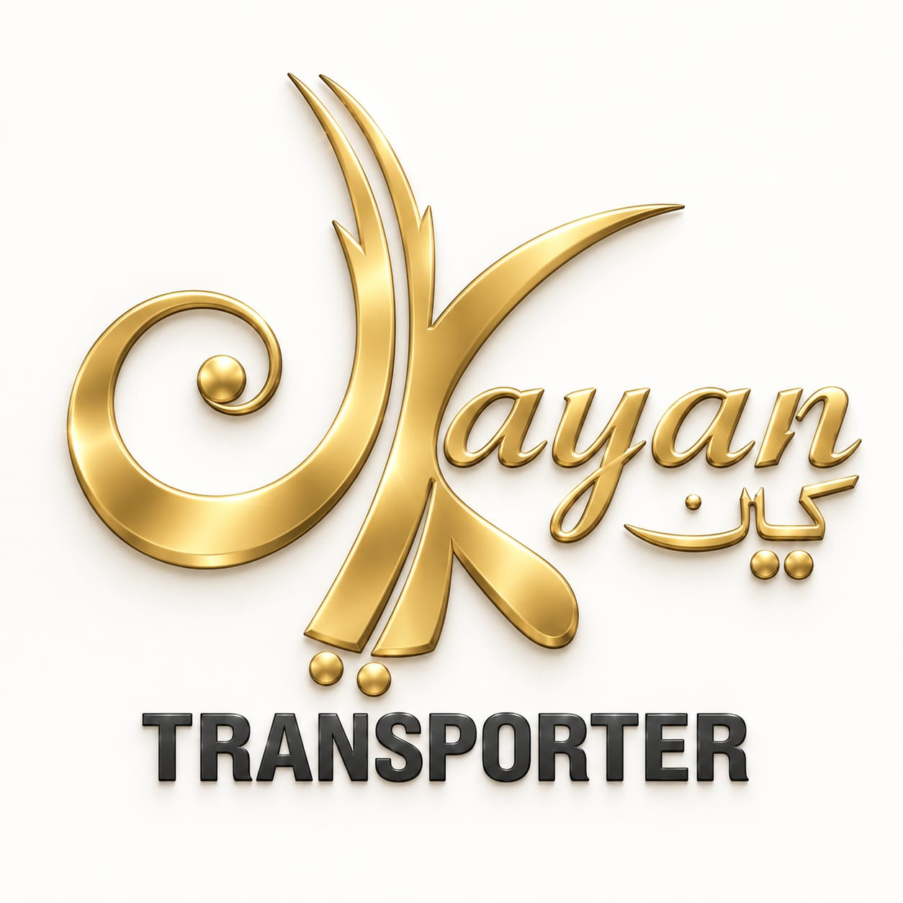

  

  <h1>🚌 Kayan Transporter</h1>

  
<em>رحلة آمنة لأطفالك كل يوم — A Safe Journey for Your Children, Every Day</em>

  
  
  

---

---

## 📎 Project Name

> **Kayan Transporter** 

---

## 📌 Project idea

شركة **Kayan Transporter** هي شركة نقل مدرسي معتمدة مقرها مدينة 6 أكتوبر، القاهرة، مصر. تقدم الشركة خدمة نقل مدرسي آمنة تعتمد على التكنولوجيا الحديثة لتوصيل الطلاب في المدارس الخاصة والدولية في نطاق الهرم وأكتوبر وحدائق أكتوبر والشيخ زايد والقاهرة الجديدة.

- **المشكلة:** قلق الأمهات وتأخر الباصات وعدم وجود تتبع.
- **الحل:** كيان توفر تتبع GPS مباشر، مواعيد ثابتة، مشرفات مدربات، وسيارات تويوتا هاياس حديثة مع تغطية تأمينية شاملة.

> 🗣️ **Brand Slogan:**
> *"كيان هتوصل ابنك في ميعاده.. وبأمان"*

---

## 👥 Team Members

<table align="center">
  <thead>
    <tr>
      <th align="center">#</th>
      <th align="center">Name</th>
      <th align="center">Role</th>
    </tr>
  </thead>
  <tbody>
    <tr>
      <td align="center">1</td>
      <td align="center"><b>Asmaa Abdelmohsen Mohamed Mohamed</b></td>
      <td align="center">👑 Team Leader</td>
    </tr>
    <tr>
      <td align="center">2</td>
      <td align="center">Abdelrhman Ahmed Elsayed Abdelmaksoud</td>
      <td align="center">Member</td>
    </tr>
    <tr>
      <td align="center">3</td>
      <td align="center">Ali Eldeen Magdi Ali Kotb</td>
      <td align="center">Member</td>
    </tr>
    <tr>
      <td align="center">4</td>
      <td align="center">Basma Ali Abbas Hussein</td>
      <td align="center">Member</td>
    </tr>
    <tr>
      <td align="center">5</td>
      <td align="center">Esraa Amr Mohamed Waheeb</td>
      <td align="center">Member</td>
    </tr>
  </tbody>
</table>

---

## 🎓 Instructor

> **Dr. Sameh Ibrahim**

---

## 🎯 Project Objectives

- 📈 زيادة الوعي بعلامة كيان ترانسبورتر بين أولياء الأمور في الهرم وأكتوبر والشيخ زايد والقاهرة الجديدة.
- 👨‍👩‍👧 &nbsp; بناء الثقة مع الأمهات من خلال إبراز مميزات الأمان (GPS، مشرفات، مواعيد).
* 📱 تنمية الحضور الرقمي على منصات السوشيال ميديا المختلفة (فيسبوك - انستجرام - تيك توك - سناب شات - لينكدان) ومحرك البحث جوجل.
*  💰 توليد Leads مؤهلين وتحويلهم لمشتركين في الخدمة.
- 📊 وضع KPIs قابلة للقياس لمتابعة الأداء التسويقي.

---

## 📦 Project Scope

بناءً على **SOSTAC Planning Model**:

| Stage | Scope & Content |
|-------|-----------------|
| 🔍 **Situation** | Internal Analysis, Customer Analysis, Competitor Analysis, PEST, SWOT |
| 🎯 **Objectives** | SMART Financial & Marketing Objectives |
| 🗺️ **Strategy** | Segmentation, Target Market, Buyer Persona, USP |
| ⚙️ **Tactics** | Marketing Mix, Content Calendar, Platforms, Tone of Voice, POCs |
| 🚀 **Action** | Action Plan, Budget, Roles, Account Creation, Content Execution |
| 📊 **Control** | KPIs, Analytics Reports, Recommendations |

---

### 🏆 Final Deliverable

خطة تسويق رقمي متكاملة مُصممة في عرض تقديمي + إنتاج محتوى مرئي لمنصات السوشيال ميديا المختلفة (بوستات سوشيال ميديا، فيديوهات، كاروسيل، إنفوجرافيك) + تقارير تحليلية

---

## 🛠️ Tools Used

| Category | Tools |
|----------|-------|
| 🎨 Design | Canva |
| 🎬 Video Editing | CapCut |
| 🎥 Visuals & Scene Generation | Google Flow, Dola AI |
| 🤖 AI (Captions & Prompts) | ChatGPT, Gemini, Copilot |
| 🎙️ Voiceover | ElevenLabs, Google AI Studio |
| 📊 Planning | PowerPoint, Business Model Canvas, SOSTAC |
| 🔍 Research & Persona | Google Trends, HubSpot (Make My Persona Tool) |
| 📲 Publishing | Meta Business Suite, YouTube Studio, TikTok, Snapchat, LinkedIn, Google Ads |
| 📈 Data | Excel |

---

## ⚠️ Challenges & Solutions

<table dir="rtl" width="100%">
  <thead>
    <tr>
      <th align="center" width="5%">#</th>
      <th align="center" width="40%">التحدي</th>
      <th align="center" width="55%">الحل</th>
    </tr>
  </thead>
  <tbody>
    <tr>
      <td align="center">1</td>
      <td align="right">بناء ثقة أولياء الأمور في خدمة تخص سلامة أطفالهم</td>
      <td align="right">إبراز عناصر الأمان في المحتوى: تتبع GPS مباشر، مشرفات مدربات، مواعيد ثابتة، وتغطية تأمينية شاملة</td>
    </tr>
    <tr>
      <td align="center">2</td>
      <td align="right">الوصول الدقيق للجمهور المستهدف (الأمهات وأولياء الأمور في القاهرة والجيزة)</td>
      <td align="right">استخدام استهداف دقيق عبر <b>Meta Business Suite</b>، واختيار أوقات الذروة لجدولة المنشورات (الساعة 11:00 مساءً)</td>
    </tr>
    <tr>
      <td align="center">3</td>
      <td align="right">اختلاف طبيعة الجمهور وأسلوب المحتوى من منصة لأخرى</td>
      <td align="right">تخصيص نوع المحتوى لكل منصة بدل نشر نفس المادة في كل مكان</td>
    </tr>
    <tr>
      <td align="center">4</td>
      <td align="right">الحفاظ على انتظام النشر دون الإفراط في عدد المنشورات حتى لا يقل تفاعل الجمهور مع كل منشور</td>
      <td align="right">جدول نشر منظم بفاصل <b>48 ساعة</b> بين كل منشور وآخر، مع تنويع المحتوى بين التوعوي والإعلاني</td>
    </tr>
  </tbody>
</table>

---

## 📅 work Plan (5 Weeks)

### 📍 Week 1 — Situation Analysis
- [ ] Internal analysis للشركة
- [ ] Customer analysis وتحديد الجمهور المستهدف
- [ ] Competitor analysis لسوق النقل المدرسي
- [ ] PEST Analysis
- [ ] SWOT Analysis

### 📍 Week 2 — Objectives & Strategy
- [ ] تحديد SMART Objectives (مالية وتسويقية)
- [ ] Market Segmentation
- [ ] تحديد Target Market
- [ ] إنشاء Buyer Persona
- [ ] تحديد USP / Competitive Advantage

### 📍 Week 3 — Tactics & Content Planning
- [ ] تحديد Marketing Mix (7Ps)
- [ ] إنشاء Content Calendar
- [ ] اختيار المنصات وتحديد نوع المحتوى والـ Tone of Voice
- [ ] كتابة Captions وعناوين لكل POC

### 📍 Week 4 — Action & Execution
* [ ] خطة العمل التفصيلية مع الميزانية وتوزيع الأدوار
* [ ] إنشاء وتهيئة حسابات السوشيال ميديا
* [ ] تنفيذ خطة المحتوى (النصي والمرئي)
* [ ] نشر المحتوى على المنصات
### 📍 Week 5 - Control

- [ ] تحديد مقاييس الأداء الرئيسية (KPIs) ومؤشرات النجاح للحملة.
- [ ] استخراج وتحليل تقارير الأداء (Analytics Reports) من Meta Business Suite وأدوات تحليل المنصات.
- [ ] تقييم أداء الحملة المباشرة والمحتوى المقارن بالأهداف التسويقية المحددة.
- [ ] تقديم التوصيات النهائية لتحسين الأداء وتطوير الخطط والمستهدفات القادمة.

---

## 👥 Roles & Responsibilities

| # | Name | Assigned Phase / Week | Primary Responsibilities & Deliverables |
| :---: | :--- | :--- | :--- |
| **1** | **Asmaa Abdelmohsen Mohamed Mohamed** | **Week 1: Situation Analysis** | Internal analysis, Customer analysis, Competitor analysis, PEST analysis, and SWOT analysis. |
| **2** | **Esraa Amr Mohamed Waheeb** | **Week 2: Objectives & Strategy** | SMART objectives (Financial & Marketing), Market segmentation, Target market, Buyer persona, and USP / Competitive advantage. |
| **3** | **Basma Ali Abbas Hussein** | **Week 3: Tactics & Content Planning** | Marketing Mix (7Ps), Content calendar, Tone of Voice, POC Captions & Headlines, and STEPPS Model implementation. |
| **4** | **Abdelrhman Ahmed Elsayed Abdelmaksoud** | **Week 4: Action & Execution** | Action plan & budget allocation, Social media accounts setup, Content execution (Photo, Video & Infographic), and Content publishing. |
| **5** | **Ali Eldeen Magdi Ali Kotb** | **Week 5: Control** | Defining KPIs & success metrics, Meta Business Suite Analytics, Performance evaluation vs objectives, Future recommendations. |

---

## 📊 Key Performance Indicators (KPIs)

* **Paid Campaign Performance (Facebook Ads):**
  * **Insights & Reports:** Tracking actual ad delivery, impressions, and engagement metrics using Meta Ads Manager insights.
  * **Direct Conversions:** Driving parent inquiries and direct bookings via WhatsApp (`https://wa.me/201016492717`).

* **Multi-Platform Content Execution:**
  * **Social Media Presence:** Publishing customized content, carousels, and videos across **Facebook, Instagram, LinkedIn, Snapchat, TikTok, and YouTube**.
  * **Brand Strategy:** Delivering tailored messaging and visual assets for each platform's target audience.

---

## 🔗 Project Links

| Resource | Link |
| :--- | :--- |
| 📁 Google Drive | [Kayan Transporter Drive Folder](https://drive.google.com/drive/folders/1XwqFblUyqDLciORSQC3dFheMwt6WebJS?usp=drive_link) |
| 📱 Facebook | [Facebook](https://www.facebook.com/profile.php?id=61561243933084) |
| 📸 Instagram | [Kayan Transporter Instagram](https://www.instagram.com/kayantransporter?utm_source=ig_web_button_share_sheet&mdxt=ZDNlZDc0MzIxNw==) |
| 💼 LinkedIn | [Kayan Transporter LinkedIn](https://www.linkedin.com/company/kayan-transporter/about/?viewAsMember=true) |
| 👻 Snapchat | [Kayan Transporter Snapchat](https://www.snapchat.com/@kayantransport) |
| 🎥 YouTube | [Kayan Transporter YouTube](https://youtube.com/@kayantransporter?si=dkNwohgoiwmw_Ik3) |
| 🎬 TikTok | [Kayan Transporter TikTok](https://www.tiktok.com/@kayan_transporter?is_from_webapp=1&sender_device=pc) |
| 📧 Email | kayan.transportation000@gmail.com |
| 📞 Phone | 01016492717 - 01550390603 |

---

## 🏢 About The Client — Kayan Transporter

> *"شركة كيان مش مجرد شركة باصات مدارس، دي منظومة متكاملة بتقدم أمان، راحة، ورعاية حقيقية لأولادك"* 🚌

| Detail | Info |
|--------|------|
| 📍 Location | 6 October City, Cairo, Egypt |
| 🏫 Partner Schools | Japanese School, Masr Language School, IPS (3 branches), Infinity, New Vegain, Franco Al-Motamayez |
| 🚌 Fleet | Toyota Hiace — 14 seats |
| 👩 Supervisors | Trained female supervisors on every bus |
| 📡 Technology | Real-time GPS tracking |
| 🛡️ Insurance | Full coverage |
| ⏰ Service | Always open |
| 📍 Coverage | El Haram, October City, Sheikh Zayed, Aktobur Gardens , New Cairo|

---

*Graduation Project — Digital Marketing Specialist Track*
**Group 1 | Kayan Transporter** 🚌

